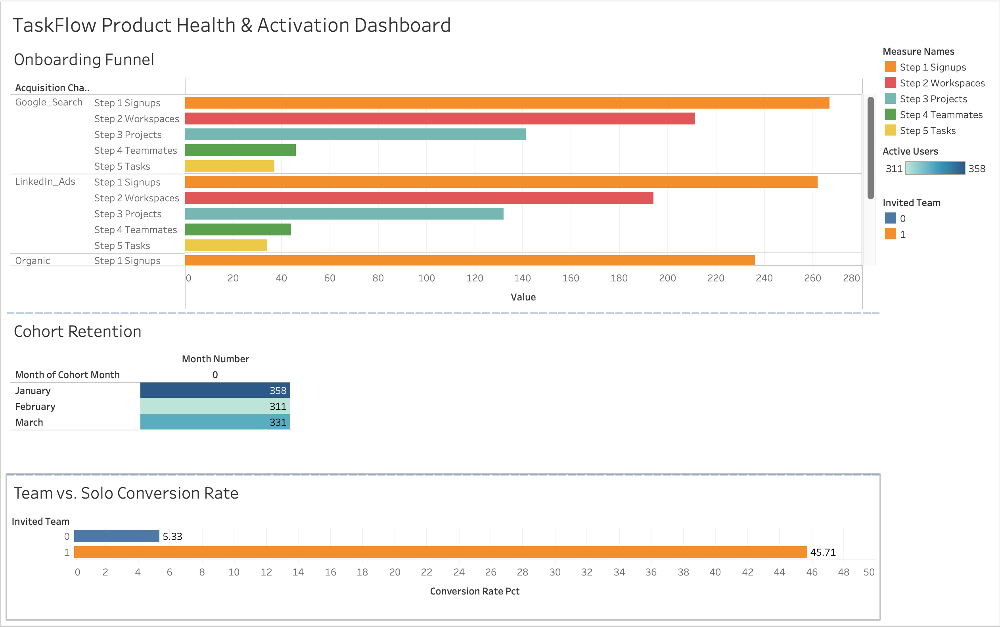

# 🚀 TaskFlow: SaaS User Activation, Cohort Retention & Churn Engine 
**Role Target:** Product Data Analyst / Growth Analyst  
**Tech Stack:** SQL (SQLite / PostgreSQL), Python (Pandas), Advanced Excel, Product Analytics  

---

## 📌 Executive Summary (The $969k ARR Opportunity)
TaskFlow is a high-growth B2B productivity and workflow management SaaS application. Despite acquiring **25,000 new trial signups annually** ($250,000 marketing investment), Monthly Recurring Revenue (MRR) plateaued due to severe onboarding drop-offs and trial-to-paid churn.

As the Lead Product Data Analyst, I audited raw clickstream event logs and subscription data across the user lifecycle. 

### 🔑 Key Strategic Findings:
1. **The 65% Onboarding Funnel Cliff:** Over 65% of all users who created a project abandoned onboarding before reaching Step 4 (**`invited_teammate`**).
2. **The Discovery:** Users who invited at least 1 teammate within their first 48 hours converted to paid subscriptions at **45.71%**, compared to just **5.33%** for solo users (an **8.6x conversion multiplier**).
3. **The Financial Impact:** Redesigning onboarding to prioritize early team collaboration (lifting teammate invites from 15% to 35%) projects **+$38,784 in net new ARR per 1,000 monthly signups**, translating to **+$969,600 in unlocked Annual Recurring Revenue** across the annual user base.

---

## 🗄️ Database Schema & Architecture

The analysis was performed across three core relational tables:
* **`users`:** User demographic and acquisition data (`user_id`, `signup_date`, `acquisition_channel`, `country`, `company_size`).
* **`user_events`:** Clickstream event logs capturing the 5-step onboarding journey (`event_id`, `user_id`, `event_name`, `event_timestamp`, `platform`).
* **`subscriptions`:** Monetization and status records (`subscription_id`, `user_id`, `plan_tier`, `monthly_price`, `start_date`, `churn_date`, `status`).

---

## 🔍 Analytical Deliverables & Core SQL Queries

### 1. The 5-Step Onboarding Funnel Audit (SQL)
Isolating stage-by-stage drop-offs using conditional aggregations and multi-table joins:

```sql
SELECT 
    u.acquisition_channel,
    COUNT(DISTINCT CASE WHEN e.event_name = 'signup_completed' THEN u.user_id END) AS step_1_signups,
    COUNT(DISTINCT CASE WHEN e.event_name = 'workspace_created' THEN u.user_id END) AS step_2_workspaces,
    COUNT(DISTINCT CASE WHEN e.event_name = 'first_project_added' THEN u.user_id END) AS step_3_projects,
    COUNT(DISTINCT CASE WHEN e.event_name = 'invited_teammate' THEN u.user_id END) AS step_4_teammates,
    COUNT(DISTINCT CASE WHEN e.event_name = 'first_task_completed' THEN u.user_id END) AS step_5_activated
FROM users AS u
JOIN user_events AS e ON u.user_id = e.user_id
GROUP BY u.acquisition_channel;

```

2. Monthly Cohort Retention Matrix

Tracked month-over-month user retention decay using a multi-CTE architecture:
code SQL
```sql
WITH user_birth_month AS (
    SELECT 
        user_id,
        MIN(strftime('%Y-%m-01', event_timestamp)) AS cohort_month
    FROM user_events
    GROUP BY user_id
),
user_activity_months AS (
    SELECT 
        e.user_id,
        b.cohort_month,
        (CAST(strftime('%Y', e.event_timestamp) AS INT) - CAST(strftime('%Y', b.cohort_month) AS INT)) * 12 +
        (CAST(strftime('%m', e.event_timestamp) AS INT) - CAST(strftime('%m', b.cohort_month) AS INT)) AS month_number
    FROM user_events AS e
    JOIN user_birth_month AS b ON e.user_id = b.user_id
)
SELECT 
    cohort_month,
    month_number,
    COUNT(DISTINCT user_id) AS active_users
FROM user_activity_months
GROUP BY cohort_month, month_number
ORDER BY cohort_month ASC, month_number ASC;

```

3. Activation Analysis

Proved the statistical link between early team collaboration and paid conversion:
code SQL
```sql
WITH user_flags AS (
    SELECT 
        u.user_id,
        MAX(CASE WHEN e.event_name = 'invited_teammate' THEN 1 ELSE 0 END) AS invited_team,
        MAX(CASE WHEN s.subscription_id IS NOT NULL THEN 1 ELSE 0 END) AS converted_to_paid
    FROM users AS u
    LEFT JOIN user_events AS e ON u.user_id = e.user_id
    LEFT JOIN subscriptions AS s ON u.user_id = s.user_id
    GROUP BY u.user_id
)
SELECT 
    invited_team,
    COUNT(user_id) AS total_users,
    SUM(converted_to_paid) AS total_conversions,
    ROUND((SUM(converted_to_paid) * 100.0 / COUNT(user_id)), 2) AS conversion_rate_pct
FROM user_flags
GROUP BY invited_team;

```

Results Summary:

    Solo Users (invited_team = 0): 5.33% Conversion Rate

    Team Users (invited_team = 1): 45.71% Conversion Rate (8.6x Multiplier)

## 📈 Financial Sensitivity Model (Excel)
A dynamic sensitivity model built to evaluate the Annual Recurring Revenue (ARR) upside of optimizing the onboarding flow:

* **Baseline Assumptions:** 1,000 monthly signups | ARPU = $40.00/month | 15% team invite rate.
* **Optimized Scenario:** Redesigned onboarding lifting team invite rate to 35%.

* **Baseline ARR:** 114 new customers/mo × $40 × 12 = **$54,720**
* **Projected ARR:** 194 new customers/mo × $40 × 12 = **$93,120**
* **Net Annual Impact:** **+$38,784 ARR per 1,000 monthly signups**

**Scaled Across Annual Signups (25,000 users):** 
25 × $38,784 = **+$969,600 New ARR**

---

## 🎯 Strategic Product Recommendations
1. **Move Teammate Invites to Step 2:** Prompt team collaboration during initial workspace setup rather than burying it inside project settings.
2. **Incentivize Team Onboarding:** Offer an extended 30-day trial for teams that invite 2 or more colleagues within 48 hours.
3. **Deprioritize Single-Player Acquisition Campaigns:** Shift ad spend away from solo-freelancer keywords toward team-oriented B2B keywords on LinkedIn and Google Search.

---

## 📊 Interactive Tableau Dashboard
Explore the live, interactive executive dashboard here:  
**[Click here to view on Tableau Public](https://public.tableau.com/app/profile/bliss.bliss/viz/TaskFlowProductAnalyticsDashboard/TaskFlowProductHealthActivationDashboard)**


